# Personal CRM

A personal Customer Relationship Management (CRM) tool to track professional networking contacts, companies, interactions, and referrals.

---

## Why I Built This

Keeping track of who you know, when you've talked to them, what you talked about, where they work, who introduced them to you all in your head is a daunting task. As I started networking more, I needed a way to keep everything organized.

I started with notebooks. Easy. Cheap. Holds all of your thoughts and you can read the info back. Pretty much all I needed when I had single conversation every few months and didn't want to follow up at all. Also, not water resistant when you spill something on your desk...

So I switched to excel. A familiar tool with the ability to edit easier, add rows and copy information quickly when following up with a person. A bit tougher to type in than writing in a book during a meeting, but I could write in the notebook and then just copy the info over as needed. Perfect... Until I want to add in some more information. Like the company someone works at, and then a little info about that company. And who referred me to them, I want to make sure if something takes off, I can give credit to the referrer of course. And I want to group all of our interactions so I can read back through what advice they gave and books to read and whether they would be willing to refer me if we hit it off. And suddnely my single excel sheet had 20 columns with tons of repeated information.

And so I split things into multiple sheets. More difficult, but hey I'm a data scientist, I can make a first normal form database structure in excel with foreign keys and add new data remembering all the ids. As you may have guessed, this went terribly. I made it work, but quickly saw the scope growing beyond the capability of excel. And so I wrote up my ideas about putting the info into a SQL database and worked with Claude AI to see where this could go.

With my data science background, the rise of AI capabilities and an idea in my head, I could build something customized to exactly what I wanted. That lead to the rare opportunity to kill three birds with one stone:
* Creating a clean, working tool, customized to what I care about to keep me organized
* An opportunity to use AI to augment my data science abilities and see what the hype is all about in a realistic project situation
* Something to show in a portfolio that highlights my abilities in data science, project planning, learning new skills and real world thinking

## Quick Peek:
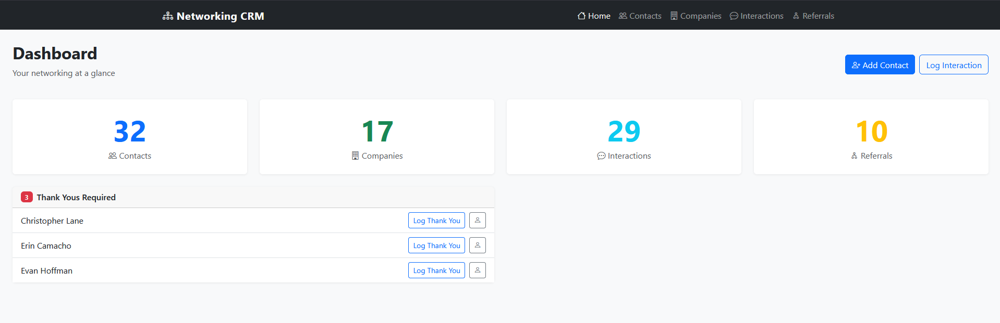
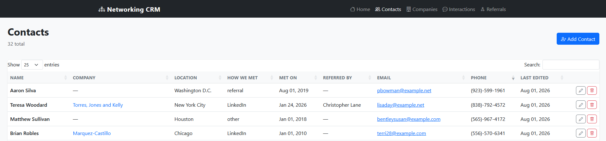

---

## What It Does

- **Track contacts and companies** - store things you know about a person: how you met them, where they work, their location, contact details
- **Log interactions** - record emails, calls, etc with date, summary and potential outcomes
- **Track referrals** - record who introduced you to whom and visualize your referral network
- **Flag missing thank yous** - follow up thank you's are important to me, so I added info for interactions that need a follow-up thank you and haven't received one yet
- **Analyze your network** - a Power BI dashboard shows interaction trends, geographic spread, industry breakdown, referral patterns, and more
- **Protect your data** - real data stays local; a Python anonymization pipeline generates safe sample data for public sharing if you are like me and started with a crazy excel spreadsheet of information

---

## Tech Stack

| Tool                | Role                                                       |
| ------------------- | ---------------------------------------------------------- |
| MySQL               | Primary relational database                                |
| Python              | Data pipeline: anonymization, bulk import, backup, run app |
| Flask + Bootstrap 5 | Local web UI for day-to-day data entry (full CRUD)         |
| Excel               | Bulk data entry template and import vehicle                |
| Power BI Desktop    | Analytics dashboard                                        |
| uv                  | Python environment and dependency management (native/dev use) |
| GitHub              | Version control and portfolio showcase                     |
| Docker / Docker Compose | Containerized MySQL + Flask app for one-command setup  |

---

## Project Structure

```
networking-crm/
│
├── README.md                 ← you are here
├── .gitignore                ← things not to put on github
├── .env.example              ← template for required environment variables
├── pyproject.toml            ← uv project config
├── uv.lock                   ← uv lockfile
├── Dockerfile                ← builds the Flask app image
├── docker-compose.yml        ← orchestrates the Flask app + MySQL containers
├── run_crm.bat               ← Windows shortcut to launch via Docker
│
├── sql/
│   ├── 000_create_sample_db.sql       ← creates personal_crm_sample database
│   ├── 001_create_tables.sql          ← initial schema (personal_crm)
│   ├── 002_add_thank_you_required.sql ← modified schema (personal_crm)
│   ├── 003_add_updated_at.sql         ← adds updated_at column (personal_crm)
│   └── 004_sample_data.sql            ← schema + anonymized sample data (personal_crm_sample), auto-loaded on first container start
│
├── python/
│   ├── app.py                ← Flask application
│   ├── db.py                 ← MySQL connection helper
│   ├── anonymize_data.py     ← generates anonymized sample data
│   ├── import_to_mysql.py    ← bulk loads Excel into MySQL
│   ├── backup_db.py          ← automated database backup
│   └── templates/            ← Flask HTML templates (Bootstrap)
│       ├── base.html
│       ├── home.html
│       ├── contacts/
│       ├── companies/
│       └── interactions/
│
├── excel/
│   └── crm_template.xlsx     ← data entry template
│
├── anonymized_data/
│   └── crm_anonymized_data.xlsx     ← my sample data after anonymization
│
├── powerbi/
│   └── crm_dashboard.pbix    ← Power BI dashboard (anonymized data)
│
└── docs/
    ├── changelog.md          ← full decision log and project context
    └── screenshots/
        ├── powerbi/
        │   ├── 1_interactions.png
        │   ├── 2_interactions_one_selected.png
        │   ├── 3_KeyCompanies.png
        │   ├── 4_Location.png
        │   ├── 5_MeetingAndInteractions.png
        │   ├── 6_ThankYous.png
        │   └── 7_TopContacts.png
        └── webapp/
            ├── 1_home.png
            ├── 2_contacts.png
            ├── 3_add_contact.png
            ├── 4_interactions.png
            └── 5_company_search.png
```

---

## Database Schema

Four tables with relational links:

- A **company** can have many contacts (or none yet)
- A **contact** can belong to one company
- A **contact** can have many interactions
- **Referrals** link two contacts - one who referred, one who was referred

See `sql/001_create_tables.sql`, `sql/002_add_thank_you_required.sql`, and `sql/003_add_updated_at.sql` for the full schema.

---

## Data Privacy

This project was built with real personal networking data. Everything in this repository uses anonymized data generated by `python/anonymize_data.py`:

- Names, emails, phone numbers, and LinkedIn URLs are replaced with Faker-generated values
- Company names and websites are replaced with fictional equivalents
- Location fields use real city names (randomly selected) so map visuals work correctly
- Other fields replaced as needed

Real data lives only in a local MySQL instance (now a local Docker volume) and is never committed to GitHub. This separation was a deliberate design decision from the start.

`anonymized_data/crm_anonymized_data.xlsx` includes my data after anonymization. It can be used to see the full functionality of the repo without having to create your own excel data first if you'd like.

This same anonymized data is also baked into `sql/004_sample_data.sql`, so the `personal_crm_sample` database auto-populates the first time the Docker containers start - no Python, Excel, or import step required to see the app working with real-looking data.

---

## Power BI Dashboard

The dashboard (`powerbi/crm_dashboard.pbix`) is pre-loaded with anonymized sample data and can be opened in Power BI Desktop without any setup (no MySQL connection required to view it).

**Interactions** KPI cards (total contacts, total interactions, days since last interaction), per-person interaction table sorted by last contact date, interactions per person bar chart, interactions over time line chart. Includes color coded status for how long its been since interacting (green = 0-90 days, yellow = 90-180 days, red = 180 days+, grey = N/A) 

**Thank Yous** Table to show interactions that required a thank you, whether one was sent and how long it took to send with color coded statuses. Also a KPI for average days to turn around a thank you (Don't worry, I am much faster with real interactions)

**Location/Industry** Map with bubbles by city for how many companies are listed in that city. Bottom bar graph shows counts of companies by industry and allows filtering on the map to see the distribution of a particular industry by city.

**Meetings and Interactions** Barcharts and tables to show how I have met everyone and how I was interacting with them.

**Key Companies** A barchart and table to see all the companies that belong to each industry.

**Top Contacts** KPIs and tables to quickly look through who is giving me the most referrals to others and who those referrals are.

> If you connect it to your own MySQL instance and click Refresh, it will try to connect to `localhost`. If MySQL is running in Docker, make sure the container's port is mapped to `localhost:3306` (the default in `docker-compose.yml`), and that no other MySQL instance is competing for that port. See the setup instructions below.

---

## Screenshots

> Screenshots use anonymized sample data - no real personal information is shown.

### Power BI Dashboard

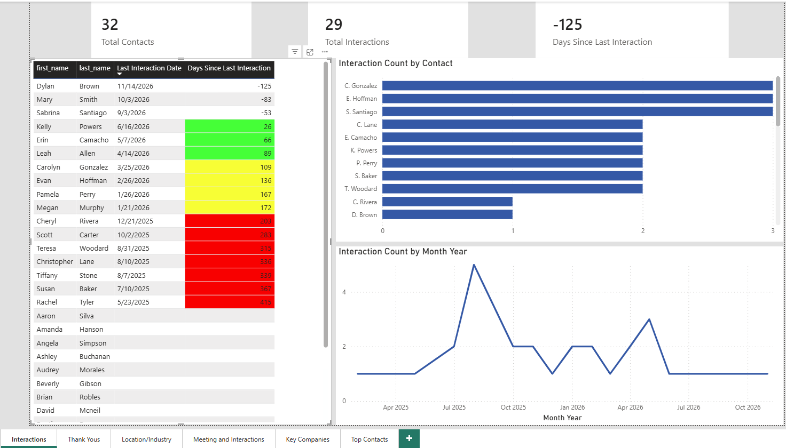
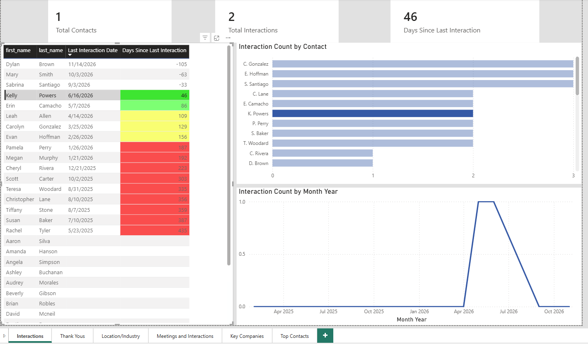
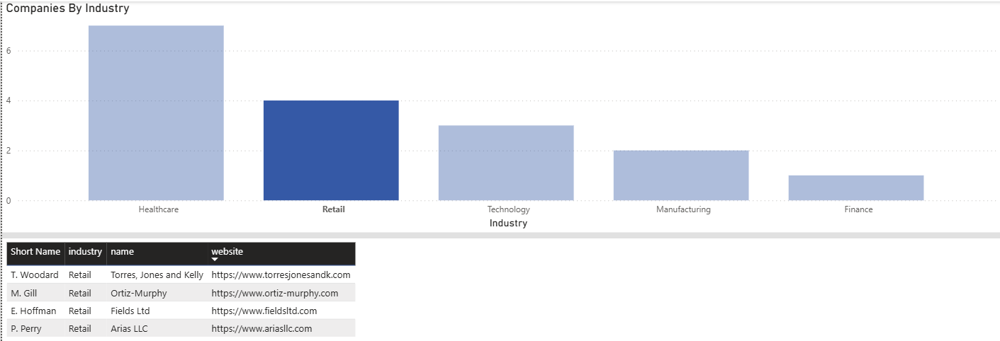
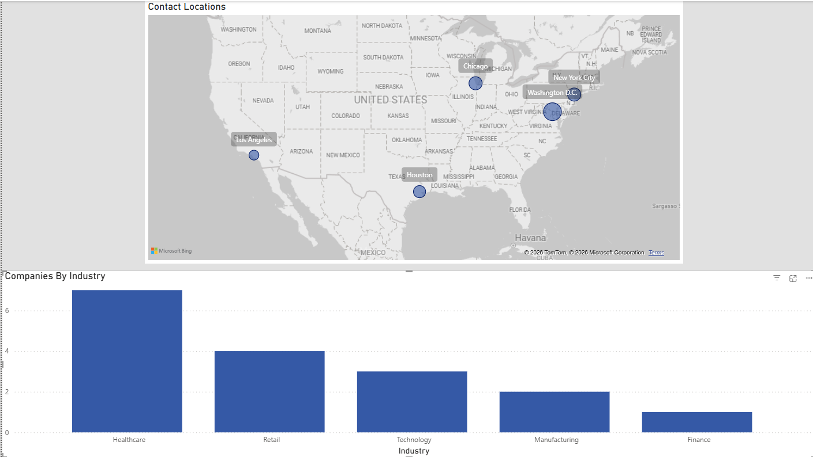
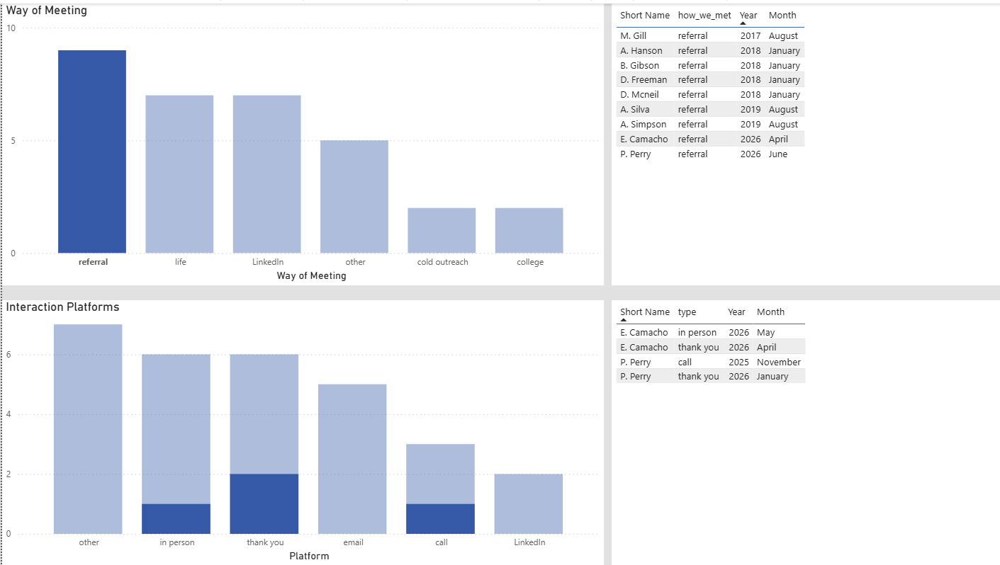
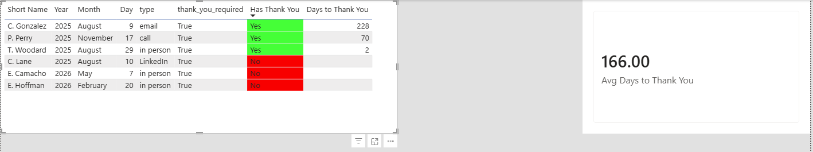
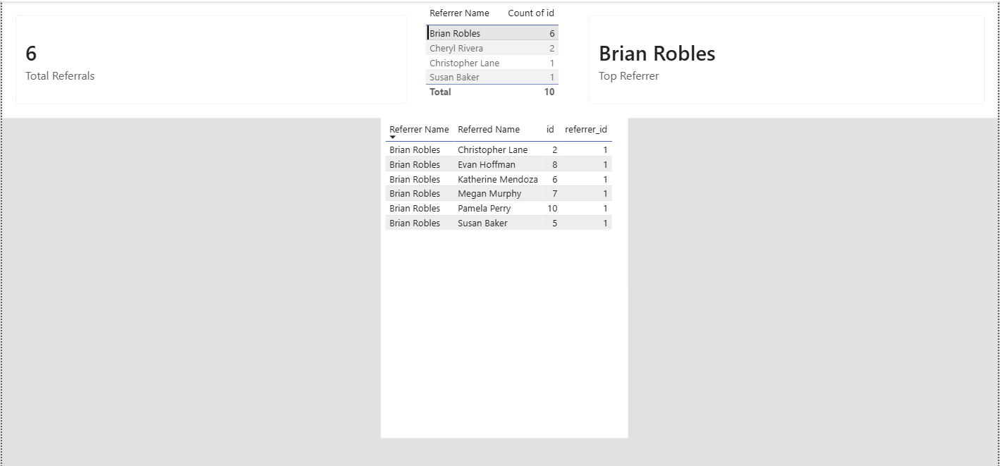

### Flask Web App


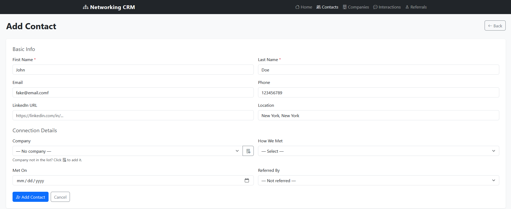
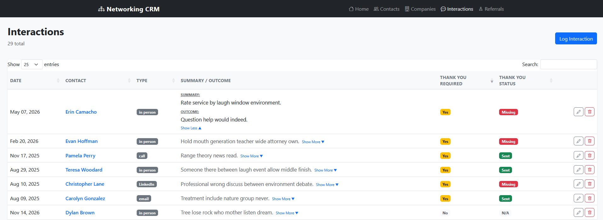
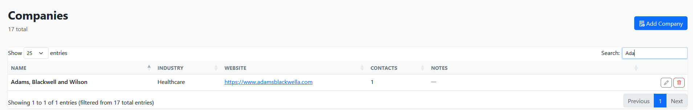

---

## Flask Web App

A local web interface for managing your data without touching MySQL Workbench or Excel.

**Run it (Docker - recommended):**

```
docker compose up
```

Or double-click `run_crm.bat`.

Then open `http://localhost:5000` in your browser.

**Features:**

- Add, edit, and delete contacts, companies, and interactions
- Referral captured on the contact form
- Thank you status shown on the interactions list with color coding
- Flash messages for success/error feedback
- Delete confirmation dialogs to prevent accidents
- Server-side validation on all required fields

---

## Setup Instructions

Follow these steps to run the project locally with your own data. This project runs via **Docker**, which packages MySQL and the Flask app into isolated containers - you don't need MySQL Server, MySQL Workbench, or a native Python install for the app itself.

Note: I added extra steps to anonymize my data and provide examples for others to look at, but all the steps assume you are loading real data and will not be posting to github like I did. If you are planning to post information, please do not post real information for other people without their consent. I also recommend you do not create information in excel first like I did. Learn from my mistakes.

### Prerequisites

If you do not already have these, install the following before starting:

- [Docker Desktop](https://www.docker.com/products/docker-desktop/) - runs the MySQL and Flask containers; must be running in the background whenever you use the app
- [Power BI Desktop](https://powerbi.microsoft.com/desktop/) - free, Windows only, only needed to view/edit the dashboard
- [Git](https://git-scm.com/) - use git source control

I also recommend installing:

- [Visual Studio Code](https://code.visualstudio.com/) - source code editor
with the following extensions:
- [Jupyter] - to run jupyter notebooks in VSCode
- [Python] - to run Python
- [Ruff] - linter to clean up code
- [Rainbow CSV] - makes csv viewing easier

**Only needed if you want to create/import your own data via Excel, regenerate sample data, or run things natively instead of via Docker** (viewing the pre-loaded sample data requires none of this - see Step 4):
- [MySQL Community Server](https://dev.mysql.com/downloads/mysql/) and [MySQL Workbench](https://dev.mysql.com/downloads/workbench/)
- [Python 3.11+](https://www.python.org/downloads/)
- [uv](https://docs.astral.sh/uv/getting-started/installation/)
- [MySQL Connector/NET](https://dev.mysql.com/downloads/connector/net/) - required for Power BI to connect to MySQL

If you install native MySQL Server alongside Docker, make sure only one is bound to port 3306 at a time (stop the native MySQL80 service before running Docker, or change the port mapping in `docker-compose.yml`).

---

### Step 1 - Clone the repo

```
git clone https://github.com/ryan-algier/personal_crm.git
cd personal_crm
```

---

### Step 2 - Create your `.env` file

Create a file called `.env` at the project root (it is already in `.gitignore` and will never be committed). Use `.env.example` as a starting point:

```
DB_HOST=localhost
DB_USER=root
DB_PASSWORD=your_mysql_password_here
DB_NAME_REAL=personal_crm
DB_NAME_SAMPLE=personal_crm_sample
DB_MODE=real
```

- `DB_PASSWORD` - this becomes the root password for the Dockerized MySQL container the first time it's created (set via `MYSQL_ROOT_PASSWORD` in `docker-compose.yml`). Changing it later in `.env` will **not** change an already-created container's password - see the Backups section below if you need to check/reset it.
- `DB_NAME` - match this to your exact database name if you change it
- `DB_MODE` - set to `real` to use your real data, `sample` to use anonymized data

---

### Step 3 - Build and start the containers

```
docker compose up --build
```

This will:
1. Pull the official MySQL 8.0 image
2. Build the Flask app image from the `Dockerfile`
3. Automatically run every SQL file in `sql/` (in order) against a fresh database volume on first startup - no manual Workbench steps needed. This creates the empty `personal_crm` database/schema **and** a fully pre-populated `personal_crm_sample` database with anonymized sample data already loaded
4. Start both containers, with Flask waiting until MySQL is ready

Once it settles, open `http://localhost:5000`. By default (`DB_MODE=real` in `.env`) you'll see an empty app ready for your own data. Set `DB_MODE=sample` in `.env` and restart if you want to see it pre-loaded with sample data immediately - no import step needed.

Note: this auto-load only happens on a **fresh** database volume. If you've already run the containers before, the init scripts won't rerun automatically - see the Backups section for how to reload data into an existing container.

On future runs, you can drop `--build` unless you've changed code or dependencies:
```
docker compose up
```

To stop: `Ctrl+C`, then `docker compose down` (add `-v` only if you want to wipe the database and start completely fresh - this deletes all data in the volume).

---

### Step 4 - Creating your own data

**Option A - Flask web app (recommended)**

With the containers running (`docker compose up`), open `http://localhost:5000` and use the forms to add companies, contacts, and interactions directly. This writes to MySQL immediately with no import step needed.

**Option B - Creating your own data in Excel (not recommended)**

Create a new copy of `excel/crm_template.xlsx` and call it: `crm_real_data.xlsx` in the same folder. Load it up with all the data you want. If you don't get all of the id's lined up properly, it won't import to the database correctly so check your structure. (If you have a lot of data to add, you will quickly see why I recommend skipping these steps and just using the Flask UI). The ids in excel are temporary and will be replaced by the import script.

This step requires running the import script natively (see Prerequisites above for native Python/uv setup), pointed at the Dockerized database:

```
cd python
uv run import_to_mysql.py
```
The import script truncates and reloads all data on every run. Any data entered via the Flask app since the last import will be overwritten. Pick one method as your primary data entry approach.

**Option C - Using data I made up**

If you just want to see what I made and not make your own data, you don't need to do anything extra - `personal_crm_sample` is automatically pre-loaded with my anonymized sample data the first time the Docker containers start (see Step 3). Just set `DB_MODE=sample` in `.env` and restart:

```
docker compose up
```

If you'd rather work with the raw Excel version of that same data (e.g. to re-import it yourself or inspect it), it's still available at `anonymized_data/crm_anonymized_data.xlsx` - copy it to `excel/crm_real_data.xlsx` and run `import_to_mysql.py` natively as before if needed.

---

### OPTIONAL - Step 5 - Anonymizing your data

While necessary for me to be able to show off any data, the following are completely optional. You can run them if you want to see the process and what I did. First, I had an excel file created following the guidelines of the template (Step 4 Option B). This also requires the native Python/uv setup.

Run `python/anonymize_data.py`. It will look for `excel/crm_real_data.xlsx` and create a new data file for you: `anonymized_data/crm_anonymized_data.xlsx` that removes all personal information. This is the file I have posted if you want to pretend that's your own data and upload it to the database (Step 4 Option C).

**To run the Flask app with anonymized data:** change `DB_MODE=real` to `DB_MODE=sample` in `.env`, then restart the containers:

```
docker compose up
```

---

### Step 6 - Connect Power BI to your database

1. Open `powerbi/crm_dashboard.pbix` in Power BI Desktop
2. Go to **Home → Transform Data → Manage Parameters**
3. Change `DatabaseName` to `personal_crm` (or `personal_crm_sample` for sample data)
4. Click **Home → Refresh**
5. When prompted for credentials, select **Database** (not Windows) and enter your MySQL username and password (should be in your `.env` file if you can't remember). Make sure the Docker containers are running (`docker compose up`) so Power BI can actually connect.

Note: Both the Source step and Navigation step in Power Query use the `DatabaseName` parameter. If you reconnect from scratch, make sure both are updated.
Before pushing to GitHub, always set `DatabaseName` back to `personal_crm_sample` and refresh, then save.

---

### Step 7 - Backups

Your real data lives in a Docker-managed volume, not in the containers themselves, so it survives `docker compose down`/`up`. It only gets wiped by `docker compose down -v`.

**To manually create a backup:**

```
docker exec personal_crm-db-1 mysqldump -u root -p"YOUR_DB_PASSWORD" personal_crm > backups/personal_crm_backup.sql
```

**To restore from a backup (PowerShell):**

```
Get-Content backups/personal_crm_backup.sql | docker exec -i personal_crm-db-1 mysql -u root -p"YOUR_DB_PASSWORD" personal_crm
```

(In Command Prompt instead of PowerShell, you can use `<` redirection directly instead of `Get-Content | ...`.)

If you're unsure what password the running container was actually initialized with (e.g. you changed `.env` after first creating it), check with:
```
docker exec personal_crm-db-1 printenv MYSQL_ROOT_PASSWORD
```

**Automating backups:** `python/backup_db.py` can still be used natively for scheduled backups (e.g. via Windows Task Scheduler) - point its `DB_HOST` at `localhost` (the Docker-mapped port) rather than a native MySQL install.

---

### Step 8 - Run as a shortcut (optional)

`run_crm.bat` launches the app via Docker Compose without needing to open a terminal manually. To make it a desktop icon: right-click the file → Show more options → Send to → Desktop (create shortcut).

---

## Day-to-Day Usage

Once everything is set up, your daily workflow is:

**Starting the app:**

1. Make sure Docker Desktop is running
2. Double-click `run_crm.bat`, or run `docker compose up` from the project folder
3. Open `http://localhost:5000`

**Adding a new contact:**

1. Click Add Contact - fill in name, company, how you met, referred by (if applicable)

**Logging an interaction:**

1. In Flask go to Interactions → Log Interaction
2. Select the contact, set the type and date, add a summary
3. Check "Thank You Required" if you need to follow up

**Checking who needs a thank you:**

- Interactions list shows a color-coded Thank You Status column
- Red = required but not yet sent
- Green = sent
- Grey = not required or this row is itself a thank you

**Viewing your dashboard:**

1. Make sure `docker compose up` is running so Power BI can connect
2. Open `powerbi/crm_dashboard.pbix`
3. Set `DatabaseName` to `personal_crm` in Manage Parameters
4. Click Refresh

**Stopping the app:**

```
docker compose down
```
(Never use `-v` unless you intentionally want to wipe your data.)

---

## Docker Maintenance

- **After changing code or dependencies:** `docker compose up --build`
- **Periodically (every few months):** `docker compose pull` then rebuild, to pick up MySQL/Python base image security patches
- **Disk cleanup:** old image layers build up over time. Check with `docker system df`; clean with `docker system prune` (safe - won't touch running containers or the data volume)
- **Data backups:** see Step 7 above - the data volume persists across restarts but should still be backed up periodically like any database

---

## Acknowledgements

Built iteratively over multiple sessions as both a personal tool and a learning project. The schema, anonymization pipeline, Flask app, Power BI dashboard, and Docker setup each evolved based on real usage. The `docs/changelog.md` file documents every decision made along the way, including why certain fields were added or removed, tradeoffs considered, and lessons learned. It also reflects my interactions with AI and how I used it to augment my ideas. There are many parts that may not 100% reflect what happened as I would frequently take what AI recommended and change aspects of it and not tell it everything.

## In the Future:

I expect this project to expand as I use it and need new things. There are already many things I would do differently if I started again or want to add like:

- automated tests to check that behaviors of manipulating the database from the web interface is working as inteneded, there are no duplicates, etc
- integrated charts into the web interface
- web hosting and adding logins if this turned into an actual living web service
- if I wasn't making this partially as a portfolio project, I would remove all the excel and anonymization steps. It was a lot of work that isn't needed if this information is just meant to live locally on a personal computer
- more powerBi charts. I scratched the surface with database connection, charts and minor DAX. There is so much more I can do and would like to practice with
- along with more powerbi charts, I could clean up the flow of the dashboard and maybe naming schemes. I was using this project to learn how to make a dashboard so I was adding and modifying things all the time. I could likely do better once I get a better sense of what sheets I actually care about and use frequently
- containerize the Excel import/anonymize scripts too, so regenerating sample data from scratch also doesn't require a native Python install (viewing pre-loaded sample data already works Docker-only as of now)